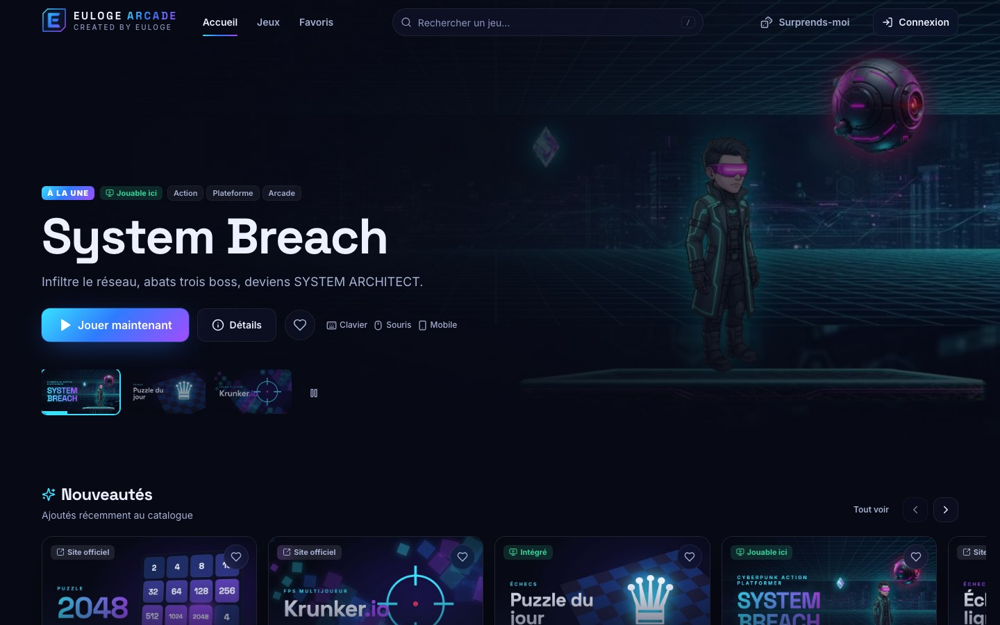
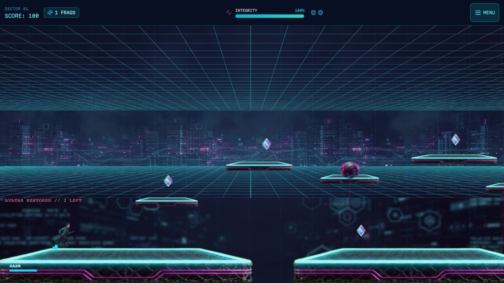
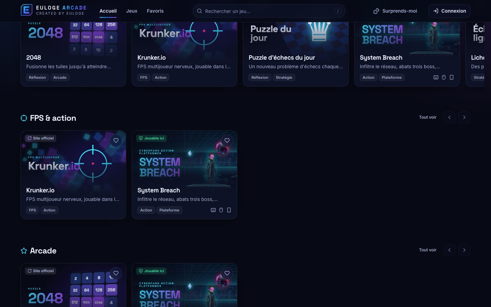
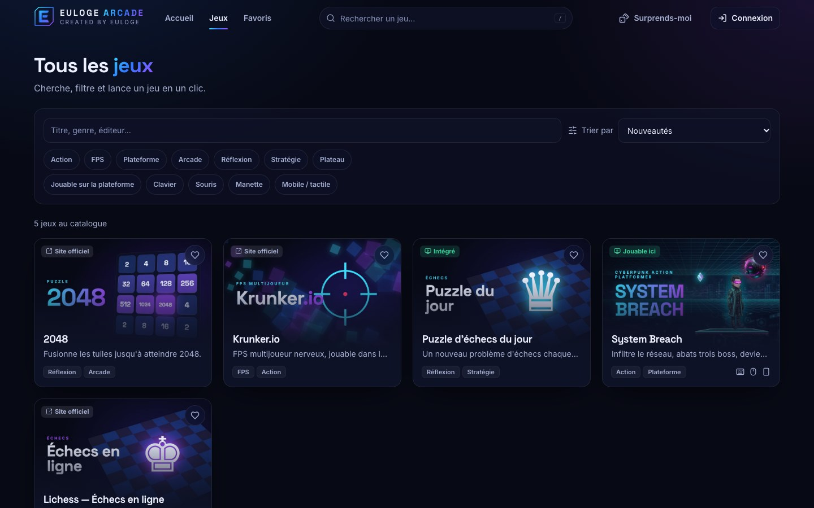
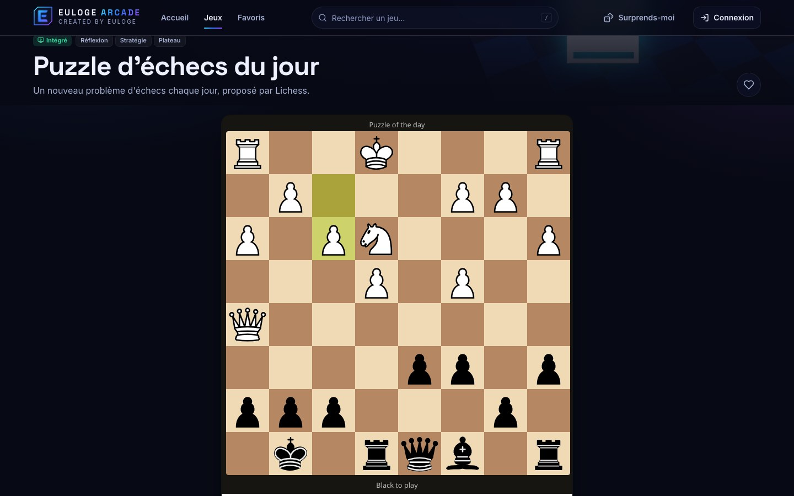
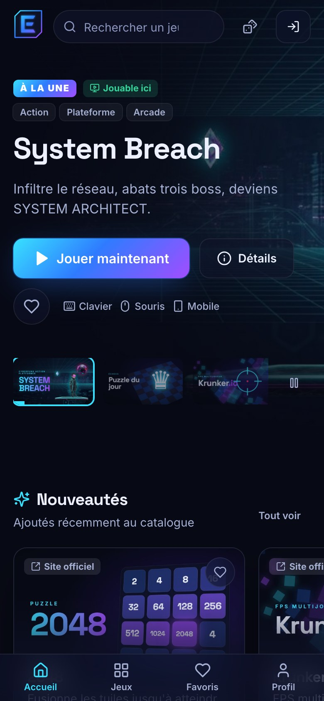
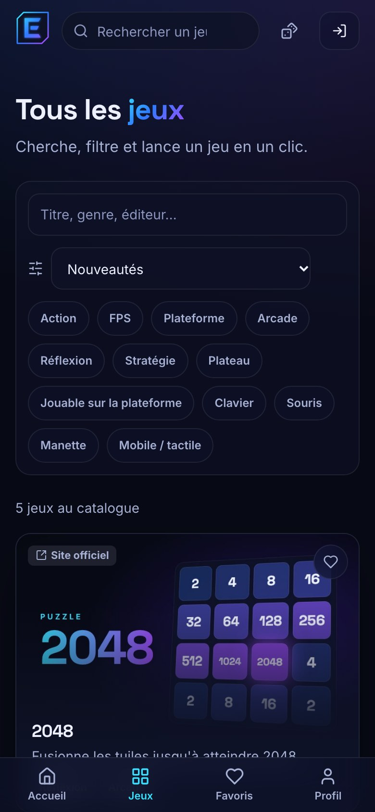
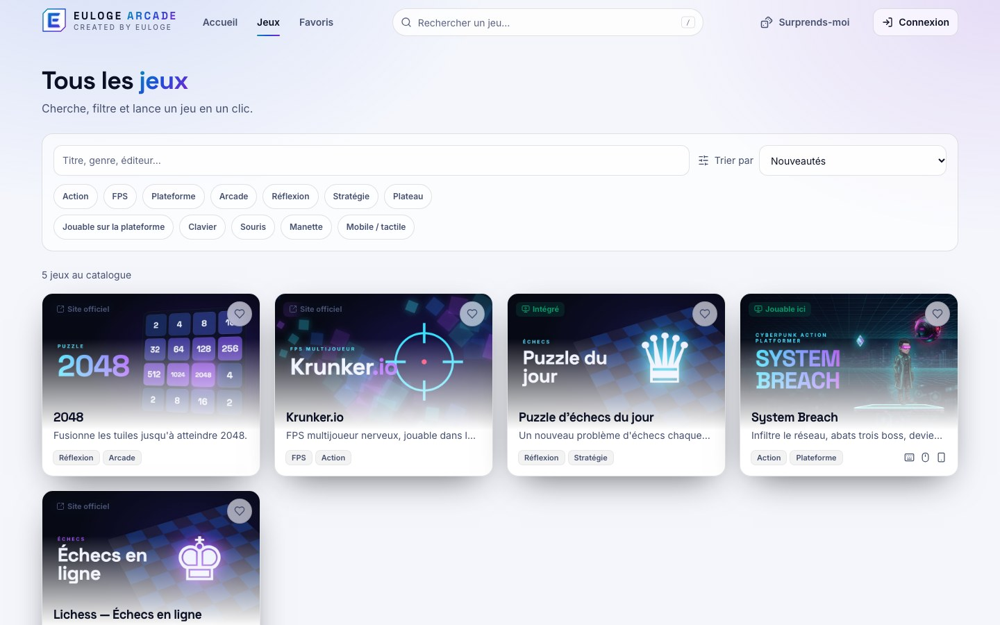

<div align="center">


# EULOGE ARCADE

### Des jeux instantanés, directement dans ton navigateur.

Découvre, lance, rejoue. Sans installation, sans publicité, sans faux compteurs.

<br />


**Created by Euloge**

</div>

<br />

<p align="center">
  
</p>

## Pourquoi Euloge Arcade ?

La plupart des portails de jeux en ligne sont des listes de liens noyées sous les publicités. Euloge Arcade part d'un autre principe : **du catalogue au premier saut du personnage en un clic**, dans une interface pensée comme une vraie boutique de jeux.

| | |
| --- | --- |
| ⚡ **Instantané** | Un jeu se lance dans la page, plein écran en un clic. Accueil affiché en **1,6 s en 4G lente**, et aucun fichier de jeu n'est téléchargé avant que tu cliques sur « Jouer ». |
| 🎮 **Trois façons de jouer** | Jeux **hébergés**, jeux **intégrés** quand leur éditeur l'autorise, et **liens officiels** pour les autres. Jamais de contournement des protections d'un site. |
| 🏆 **Une progression qui te suit** | Favoris, historique, succès, meilleurs scores et classements, synchronisés avec ton compte, ou gardés dans ton navigateur si tu joues en invité. |
| 🧭 **Une découverte honnête** | Les classements « populaires » reposent sur de vrais joueurs distincts, et une section sans données réelles reste masquée plutôt que remplie de faux contenu. |
| 🔒 **Respectueux** | Aucun jeu diffusé sans droits vérifiés. Pas de pistage, pas de pub, recommandations activées seulement si tu l'acceptes. |

## En images

<table>
  <tr>
    <td width="50%"><br /><sub><b>System Breach</b>, le jeu original de la plateforme : plateformer cyberpunk, 3 secteurs, 3 boss.</sub></td>
    <td width="50%"><br /><sub><b>Découverte</b> : rails par genre, cartes à profondeur 3D, actions au survol.</sub></td>
  </tr>
  <tr>
    <td width="50%"><br /><sub><b>Catalogue</b> : recherche instantanée, filtres, tri. L'état est dans l'URL, donc partageable.</sub></td>
    <td width="50%"><br /><sub><b>Jeu intégré</b> : le puzzle du jour de Lichess, via leur widget officiel.</sub></td>
  </tr>
</table>

<table>
  <tr>
    <td width="25%"></td>
    <td width="25%"></td>
    <td width="50%"><br /><sub><b>Mobile d'abord</b> avec barre de navigation au pouce, et <b>thème clair</b> en option.</sub></td>
  </tr>
</table>

## Les jeux

| Jeu | Mode | Droits |
| --- | --- | --- |
| **System Breach** | 🟢 Hébergé | Création originale d'Euloge |
| **Puzzle d'échecs du jour** | 🔵 Intégré | Widget officiel proposé par Lichess |
| **Krunker.io**, **2048**, **Lichess** | ↗️ Site officiel | Liens uniquement : ces sites refusent l'intégration |
| **21 projets de la liste @RadiantOpti** | ↗️ Projets externes | Quake, Halo, Zombies, Skate, PES, GTA et autres ; liens incertains conservés mais signalés indisponibles |

Les jeux tiers utilisent soit une **illustration originale** de la plateforme, soit le placeholder graphique de la marque. Aucun logo ni visuel tiers n'est réutilisé, et ces jeux restent la propriété de leurs auteurs.

### System Breach

Plateformer d'action cyberpunk : double saut, **dash** invulnérable, blaster, drones qui ripostent, combos jusqu'à x5, trois boss à phases, mode contre-la-montre, rang final S/A/B/C. Jouable au clavier, à la souris et sur mobile. Ses scores alimentent les classements de la plateforme.

## Sous le capot

```text
Navigateur
 ├─ Plateforme (React + TypeScript + Tailwind)     une chunk de code par page
 │    ├─ lectures publiques ──► REST Supabase (clé anon, RLS)
 │    └─ GamePlayer universel
 │         ├─ A · hébergé  → /games/<slug>/        bundle chargé au lancement seulement
 │         ├─ B · intégré  → iframe sandboxée, domaines de la liste blanche uniquement
 │         └─ C · externe  → lien target=_blank rel=noopener
 └─ Supabase : Postgres (RLS partout) · Auth · Storage · Edge Functions
```

- **Base de données = source de vérité** du catalogue. Les règles sensibles (rôle admin, liste blanche d'intégration, droits avant publication, chemins des jeux hébergés) sont appliquées **par la base**, pas seulement par l'interface.
- **Administration** : ajout et édition des jeux, couvertures (images uniquement, SVG refusé), licences, publication en un clic, liste blanche des domaines intégrables, détection des liens morts.
- **Accessibilité** : navigation clavier, focus visible, contrastes WCAG AA vérifiés, `prefers-reduced-motion` respecté.
- **Sécurité** : CSP sans script inline, `nosniff`, permissions restreintes, pont de scores limité à la même origine et à l'iframe exacte du jeu.

Détails et décisions : [docs/ARCHITECTURE.md](docs/ARCHITECTURE.md).

## Qualité mesurée

| | Résultat |
| --- | --- |
| Tests unitaires | **36** · recherche, filtres, tri, recommandations, succès, liste blanche, validation |
| Tests de sécurité base de données | **22** · RLS, escalade de rôle, liste blanche, droits de publication |
| Tests end-to-end | **24** · navigation, 3 modes de lancement, plein écran, lien mort, comptes, favoris, droits admin, mobile, accessibilité, CSP |
| Layout shift (4G lente, CPU ×4) | **0,002** |
| Accueil en 4G lente | **1,6 s** (affichage du plus gros élément) |
| Dépendances de production | **0 vulnérabilité connue** |

## Démarrage rapide

```bash
npm install
npm run dev            # http://localhost:5180
```

Sans configuration, la plateforme tourne en **mode local** : catalogue embarqué, favoris et historique dans le navigateur. Les comptes et l'administration sont alors désactivés.

**Avec comptes, admin et classements** (Docker et la [CLI Supabase](https://supabase.com/docs/guides/cli) requis) :

```bash
supabase start -x realtime,studio,imgproxy,vector,logflare,supavisor
cp .env.example .env.local     # renseigner l'URL et la clé ANON affichées
npm run dev
```

| Commande | Rôle |
| --- | --- |
| `npm run build` / `preview` | Build de production, aperçu |
| `npm test` | Tests unitaires |
| `npm run test:e2e` | Tests end-to-end (Supabase local requis) |
| `supabase test db` | Tests de sécurité de la base |
| `npm run brand:assets` | Régénère favicon, image de partage et couvertures |

## Mise en ligne

Cible conseillée : **Cloudflare Pages** + **Supabase**. Les en-têtes de sécurité et la redirection SPA sont déjà fournis. Pas à pas : [docs/DEPLOYMENT.md](docs/DEPLOYMENT.md).

## Ajouter un jeu

1. **Hébergé** : seulement si tu en détiens les droits, ou s'il est sous licence libre.
2. **Intégré** : seulement avec l'autorisation de l'éditeur. Le domaine est ajouté à la liste blanche.
3. **Externe** : un simple lien vers le site officiel.

Le guide complet est dans [docs/ARCHITECTURE.md](docs/ARCHITECTURE.md#ajouter-un-jeu).

## Documentation

[Audit initial](docs/AUDIT.md) · [Architecture](docs/ARCHITECTURE.md) · [Déploiement](docs/DEPLOYMENT.md) · [Identité de marque](BRANDING.md)

## Droits et licences

- **Plateforme** (code, interface, logo « E », marque, illustrations originales) : © 2026 Euloge Arcade, tous droits réservés. Voir [LICENSE.md](LICENSE.md).
- **System Breach** : jeu original du projet. Ses bibliothèques tierces sont listées dans [`games/system-breach/THIRD_PARTY_NOTICES.md`](games/system-breach/THIRD_PARTY_NOTICES.md).
- **Jeux tiers** : propriété de leurs auteurs. Euloge Arcade n'y est affilié d'aucune façon.

<div align="center">
<br />


**© 2026 Euloge Arcade. All rights reserved.** · Created by Euloge

</div>
